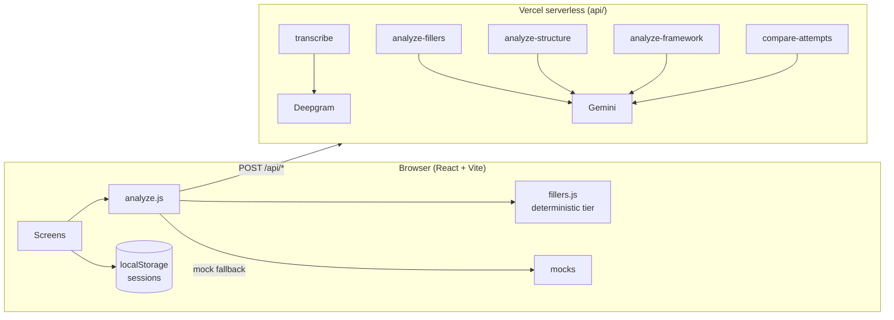

<p align="center">
  
</p>

<h1 align="center">StoryArc 🎙️</h1>

<p align="center">
  Tell a short story out loud. See your filler words and your story's shape. Retell it from memory. See exactly what improved.<br/>
  <strong><a href="https://storyarcapp.vercel.app">Try it live →</a></strong> · free with a Google sign-in
</p>

---

## Why I built it

Every speaking-feedback tool I tried gave me a score and sent me away. The thing that actually changes how you talk is much simpler: **say it, see what happened, say it again immediately, and see the difference.** StoryArc is built around that loop — and around a harder question that comes with putting an AI in the coach's chair: *how do you stop it from confidently making things up about what you said?*

Two modes:

- **Story Lab** — pick a prompt, tell the story, get feedback in two honest lanes (filler words; story shape), retell it from memory on a deliberately bare screen, then see a real comparison: *did you act on the advice, and what concretely changed — in your own words.*
- **Story Gym** — answer a given situation using a storytelling framework (ABT, SCR, or the interview classic STAR), get a verdict per beat, then hear **your own story retold through the framework** using only facts you actually said. Then do round two.

## What's interesting technically

Each of these links to the code that makes it true. There's also a **How it's built** page inside the app.

- **Anti-fabrication guardrail.** Any quote the model offers as evidence must be a verbatim ≤12-word substring of the transcript, checked in code after the call — or it's dropped, never shown. → [`evidenceIsValid`](src/lib/analyze.js) · [retry-then-drop](api/analyze-structure.js)
- **Two-tier filler detection.** A deterministic pass (fixed list + back-to-back repetition loops) runs instantly and offline; the model only adjudicates genuinely contextual cases ("like" as verb vs. hedge). The deterministic tier wins on overlap. → [`fillers.js`](src/lib/fillers.js)
- **Honest degradation.** Every analysis carries a `provider`. If any call falls back to sample data, the UI says which one — a confident fake is treated as worse than a visible gap. It's also why `npm run dev` works with zero keys. → [`analyze.js`](src/lib/analyze.js)
- **The coach checks its own homework.** Round two is analysed *alongside* round one and the exact advice given, and the model must say whether it landed — including "no". → [`compare-attempts.js`](api/compare-attempts.js)
- **Temperature is a design decision.** Judgments run at 0; prose (retelling, comparison) runs at 0.4–0.6, because temperature 0 selects the most probable — i.e. most generic — phrasing. → [`_gemini.js`](api/_gemini.js)
- **Frameworks are data.** ABT, SCR and STAR are registry entries; the picker, verdict screen, retelling renderer, offline heuristics and the prompt all derive from them. → [`frameworks.js`](src/lib/frameworks.js)
- **Measured, not just demoed.** A small eval harness scores the deterministic detector against labelled fixtures — including two known limitations kept in on purpose. → [`scripts/eval-fillers.mjs`](scripts/eval-fillers.mjs)

## Architecture



Three ways into the same pipeline: **microphone**, **typed text** (skips speech-to-text — everything downstream consumes only `Transcript.text`), or a **bundled sample recording** pushed through the real Deepgram → Gemini path. The dev server runs the identical `api/` handlers via a small Vite middleware, so there is no separate dev-mode API to keep in sync.

## Run it

```bash
npm install
npm run dev        # http://localhost:5173 — works with zero API keys (demo mode)
npm run eval       # score the deterministic filler detector against eval/fixtures
npm run build
```

Go live locally in two minutes:

```bash
cp .env.example .env.local
# GEMINI_API_KEY=...  STT_PROVIDER=deepgram  DEEPGRAM_API_KEY=...
npm run dev
```

| Env var | Unlocks |
|---|---|
| `GEMINI_API_KEY` | Filler adjudication, structure analysis, framework verdicts + retelling, cross-attempt comparison |
| `GEMINI_MODEL` | Model override (default `gemini-3.6-flash`) — models get retired, don't hardcode |
| `STT_PROVIDER` | `mock` (default) · `deepgram` · `assemblyai` · `gemini` |
| `DEEPGRAM_API_KEY` / `ASSEMBLYAI_API_KEY` | Real speech-to-text for that provider |

**Deploy:** import the repo in Vercel (it auto-detects Vite + `api/`), set the same env vars, deploy. Keys never reach the browser.

## Adding a framework

Add one entry to `FRAMEWORKS` in [`src/lib/frameworks.js`](src/lib/frameworks.js) — id, name, emoji, beats, and two prompt-guidance strings. Everything else generates itself.

## Deliberate scope decisions

- **No accounts, no database — by design.** Sessions are local-first with JSON export and a one-click clear. A public demo shouldn't ask for a sign-up, and there's nothing in the product that needs a server to remember you.
- **Two separate metrics, never a composite score.** A blended number hides which thing needs work.
- **Round two is bare.** No transcript, no fix reminder on the retry screen — that's what makes the comparison mean something.
- **Repeated phrases are flagged, emphasis is not always distinguishable.** The eval set keeps that limitation visible rather than hiding it.
- The LLM prompts are working versions with worked examples; the companion rubric files in the parent folder are the reference for the next revision.

## Project layout

```
api/            serverless handlers (transcribe, analyze-*, compare-attempts, health)
src/lib/        fillers · analyze (+ mocks + guardrail) · stt · frameworks · session · samples
src/components/ Start · LabPick · Record · Processing · Feedback · Delta · GymPick · GymFeedback · GymDelta · History · About
public/samples/ bundled sample recordings (m4a)
eval/ scripts/  labelled fixtures + eval harness
```
